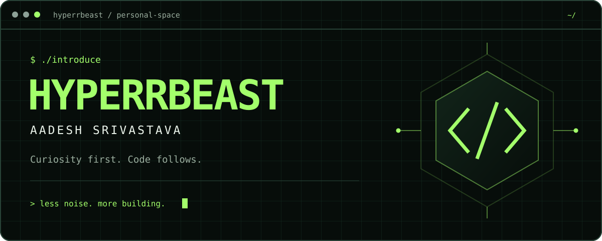

<p align="center">
  
</p>

<p align="center">
  <strong>Aadesh Srivastava</strong><br />
  A developer's corner of the internet. Built with curiosity.
</p>

<p align="center">
  <a href="https://github.com/Hyperrbeast?tab=repositories">Explore my repositories</a>
  &nbsp; / &nbsp;
  <a href="https://github.com/Hyperrbeast?tab=stars">Explore my stars</a>
</p>

---

### `01 / whoami`

```text
name       Aadesh Srivastava
handle     Hyperrbeast
location   India
space      Code, ideas, and things worth building.
```

### `02 / the mindset`

Curiosity first. Make something useful. Keep making it better.

This is my space to share what I build and what I learn along the way.

### `03 / find me`

[**@Hyperrbeast →**](https://github.com/Hyperrbeast)

---

<p align="center"><samp>LESS NOISE. MORE BUILDING.</samp></p>
